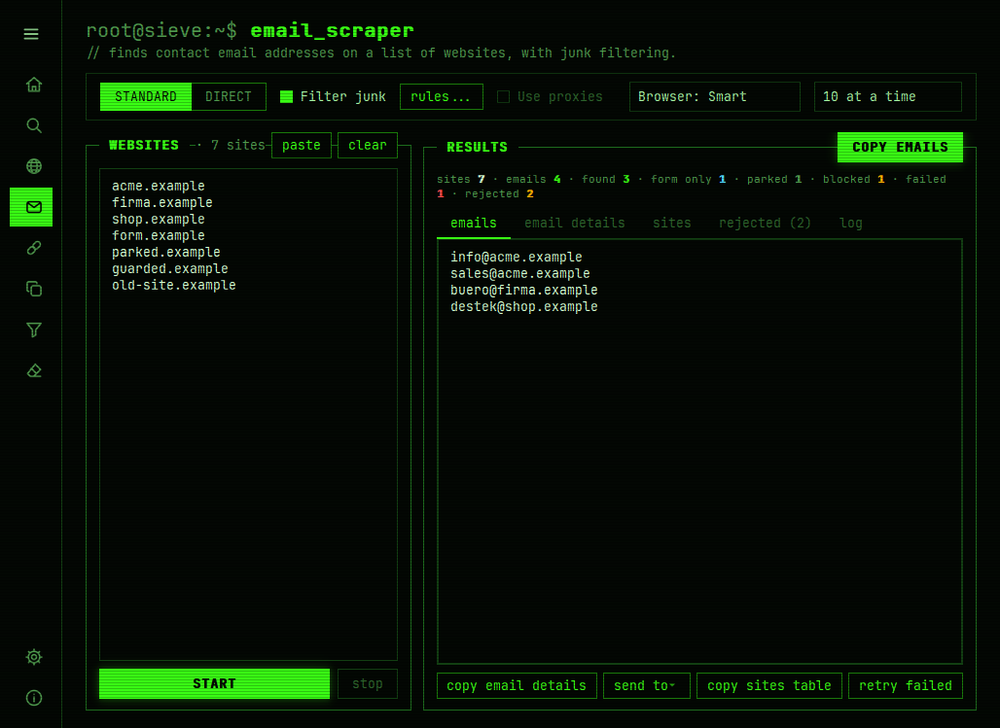
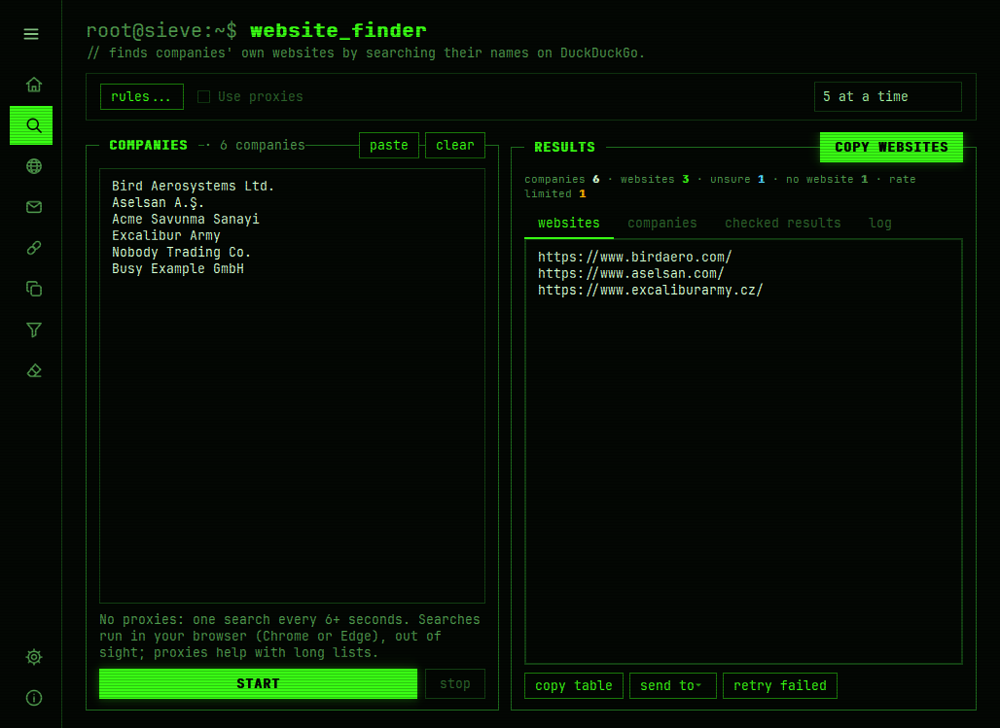
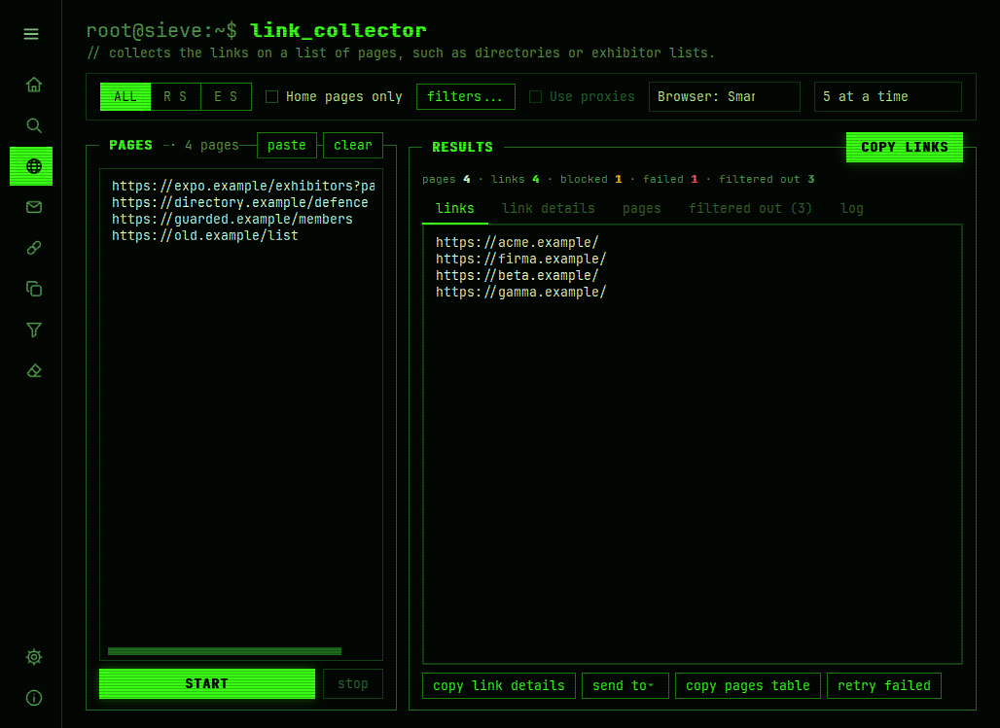
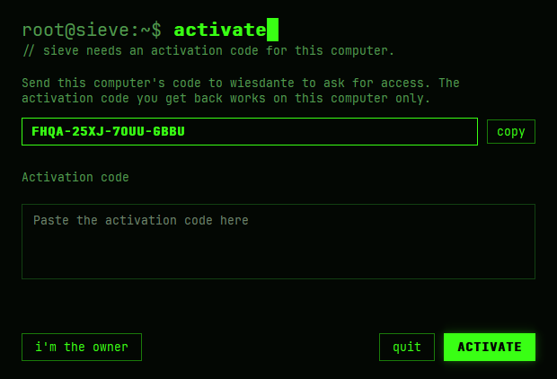

<p align="center">
  
</p>

<h1 align="center">Sieve</h1>

<p align="center">
  A desktop toolkit for data scraping: from a list of company names to their websites,<br>
  their contact pages and their email addresses, in one app.<br>
  <sub>by <b>wiesdante</b></sub>
</p>

<p align="center">
  <a href="https://github.com/wiesdante/sieve/releases/latest"></a>
  <a href="https://github.com/wiesdante/sieve/actions/workflows/ci.yml"></a>
  
  
</p>

<p align="center">
  
</p>

---

Sieve replaces a folder of one-off console scripts with a single desktop application.
Every workflow is a **tool** with its own page; tools share one proxy pool, one browser
engine and one look, and hand their results to each other with **Send to**.

> **Access:** Sieve is free to look at but not free to use. The app asks for an
> activation code tied to your computer — see [Getting access](#getting-access).

## Tools

A typical run goes left to right:

```
company names ──► Website Finder ──► Email Scraper ──► clean email list
directory pages ─► Link Collector ──┘        ▲
PDF brochures ──► Link & Email Extractor ────┘
```

| Tool | What it does |
| --- | --- |
| **Website Finder** | Searches company names on DuckDuckGo and keeps each company's **own** website — never its LinkedIn page, marketplace shop or directory entry. A result is accepted only when its domain is spelled by the company's name (legal forms such as Ltd., A.Ş. or GmbH ignored), its initials or the start of its words, or the home page's title names the company. Uncertain matches are shown separately, never mixed in. |
| **Link Collector** | Collects the links on a list of pages (directories, exhibitor lists, search results): all links, other sites only, or one home page per site, without social, share and file links, with saved exclude rules. |
| **Email Scraper** | Finds contact addresses on a list of websites. Looks for contact pages in 25+ languages, reads structured data, decodes hidden addresses (Cloudflare, ROT13, reversed text), recognises parked domains and bot checks, and opens protected or JavaScript-only sites in your browser when needed. |
| **Link & Email Extractor** | Collects links or email addresses from PDF files (clickable links and text) or pasted text. |
| **Duplicate Remover** | Removes repeated lines, keeping the first occurrence and the original order. |
| **Keyword Filter** | Keeps or removes lines containing any keyword from saved whitelists and blacklists. |
| **Text Stripper** | Removes saved phrases such as labels and prefixes from every line. |

<p align="center">
  
  
</p>

## Under the hood

- **Never mistakes a block for an empty result.** Search engines and websites answer
  scrapers with rate limits, bot checks and parking pages. Sieve recognises each of them
  and reports *rate limited*, *blocked* or *parked* — so "no website" and "no emails"
  always mean exactly that.
- **A real browser only when it helps.** Plain HTTP requests first; the system's Chrome or
  Edge (driven by Playwright, out of sight) for blocked pages, JavaScript-only pages and
  bot checks, keeping each site's cookies between pages.
- **Junk filtering built for few false positives.** Addresses are checked against the
  IANA top-level domain list, a disposable-email list refreshed monthly, placeholder and
  automated mailboxes, and optionally the domain's mail servers (MX).
- **Stuck-proof runs.** Sites run on daemon threads with hard time limits; one hanging
  site never stalls a run, and **Stop** returns within seconds.
- **Shared proxy pool.** HTTP, HTTPS and SOCKS proxies, tested from the app, rotated per
  site and per search, with rest periods and automatic removal of dead proxies.
- **Self-updating.** Checks GitHub Releases on startup, verifies the installer's SHA-256
  and installs in place.
- **Offline activation.** Codes are Ed25519 signatures tied to a machine; the signing
  key is derived from the owner's passphrase with scrypt and never stored.
- **Tested.** 400+ unit tests, browser tests against a real Edge/Chrome on Windows,
  and screenshots of every page on every change.

## Getting access

1. Download `Sieve-Setup-<version>.exe` from the
   [latest release](https://github.com/wiesdante/sieve/releases/latest) and run it.
   The installer is not code-signed, so Windows SmartScreen may warn: choose
   **More info → Run anyway**.
2. On first start Sieve shows **this computer's code**. Send it to me:
   - Email: **wiesdant3@gmail.com**
   - Discord: **wiesdante**
3. Paste the activation code you receive. It works on that computer only.

<p align="center">
  
</p>

## Built with

Python 3.12 · PySide6 (Qt 6) · Playwright · requests · Beautiful Soup · dnspython ·
PyMuPDF · cryptography · PyInstaller · Inno Setup · GitHub Actions

GitHub Actions run the tests on every push (including browser tests on Windows),
render screenshots of every page, build and publish the installer when the version
changes, and refresh the reference lists every month.

## Data locations

| What | Where |
| --- | --- |
| Application | `%LOCALAPPDATA%\Programs\Sieve` |
| Settings, saved lists and sessions | `%APPDATA%\Sieve` |
| Logs | `%LOCALAPPDATA%\Sieve\logs` |
| Downloaded updates | `%LOCALAPPDATA%\Sieve\updates` |

Uninstalling Sieve keeps your settings; delete `%APPDATA%\Sieve` to remove them too.

## Development

Requirements: Python 3.12 on Windows (the UI also runs on macOS/Linux for development).

```powershell
python -m venv .venv
.venv\Scripts\activate
pip install -r requirements-dev.txt
python -m sieve          # run from source (with PYTHONPATH=src, or `pip install -e .`)
pytest                   # tests
ruff check .             # lint
```

Building a local installer (requires [Inno Setup 6](https://jrsoftware.org/isinfo.php)):

```powershell
python scripts/make_version_info.py
pyinstaller sieve.spec --noconfirm --clean
& "${env:ProgramFiles(x86)}\Inno Setup 6\ISCC.exe" /DAppVersion=0.1.0 installer\sieve.iss
```

More documentation: [Adding a tool](docs/adding-a-tool.md) · [Release process](docs/releasing.md)

```
src/sieve/
├── app.py            application bootstrap
├── core/             scraping, filtering, search and licensing logic (no UI)
├── tools/            the tools shown in the sidebar
├── ui/               main window, pages, theme and dialogs
├── updater.py        GitHub Releases update logic
├── proxy.py          proxy parsing, rotation and health checks
├── settings.py       persistent settings (JSON)
└── credentials.py    DPAPI-encrypted secrets
installer/sieve.iss   Inno Setup installer script
sieve.spec            PyInstaller build definition
scripts/              build, release and data helpers
tests/                unit tests
```

## License

The source code is published for viewing. It is not open source: all rights are
reserved, and using, copying or redistributing Sieve needs my permission. See
[LICENSE](LICENSE).

### Third-party material

- [JetBrains Mono](https://github.com/JetBrains/JetBrainsMono) font, SIL Open Font License 1.1
  ([assets/fonts/JetBrainsMono-OFL.txt](assets/fonts/JetBrainsMono-OFL.txt)).
- Top-level domain list from [IANA](https://www.iana.org/domains/root/db) and disposable
  email domains from [disposable-email-domains](https://github.com/disposable-email-domains/disposable-email-domains)
  (CC0), refreshed monthly.
